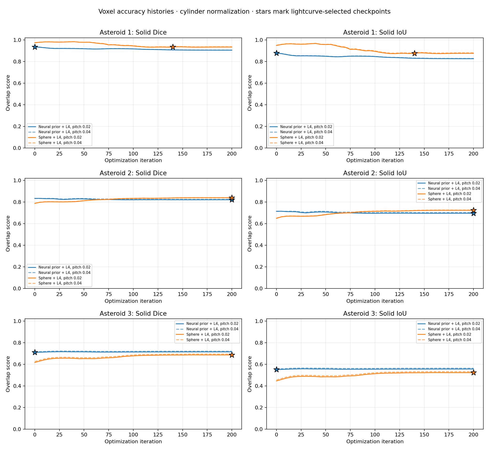
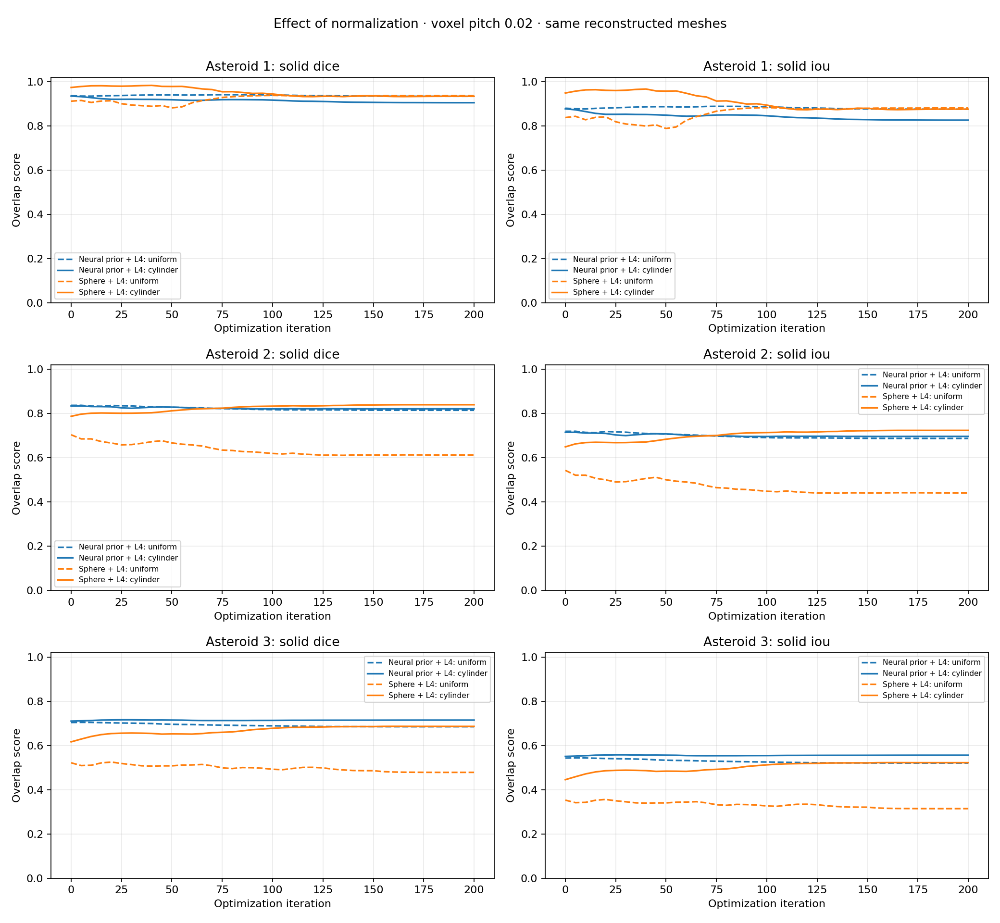

# Voxel accuracy with per-asteroid cylinder normalization

These results evaluate asteroids 1–3 using R=1.12, 1.42, and 0.88, with z=[-1,1]. Horizontal and vertical scales are independent; no rotation is fitted. Scores therefore exclude width-to-height mismatch.

All 246 checkpoint meshes passed the implemented checks, giving 492 measurements across voxel pitches 0.02 and 0.04. The plots use iteration as the horizontal axis. Stars in the accuracy plot mark lightcurve-selected states, which can be iteration zero.

| Asteroid | Method | State | Iteration | Dice | IoU |
|---|---|---|---:|---:|---:|
| 1 | prior_l4 | initial | 0 | 0.93449 | 0.87703 |
| 1 | prior_l4 | selected | 0 | 0.93449 | 0.87703 |
| 1 | prior_l4 | terminal | 200 | 0.90459 | 0.82580 |
| 1 | sphere_l4 | initial | 0 | 0.97348 | 0.94833 |
| 1 | sphere_l4 | selected | 140 | 0.93379 | 0.87581 |
| 1 | sphere_l4 | terminal | 200 | 0.93352 | 0.87532 |
| 2 | prior_l4 | initial | 0 | 0.83375 | 0.71490 |
| 2 | prior_l4 | selected | 200 | 0.82120 | 0.69665 |
| 2 | prior_l4 | terminal | 200 | 0.82120 | 0.69665 |
| 2 | sphere_l4 | initial | 0 | 0.78737 | 0.64930 |
| 2 | sphere_l4 | selected | 200 | 0.83978 | 0.72381 |
| 2 | sphere_l4 | terminal | 200 | 0.83978 | 0.72381 |
| 3 | prior_l4 | initial | 0 | 0.71003 | 0.55043 |
| 3 | prior_l4 | selected | 0 | 0.71003 | 0.55043 |
| 3 | prior_l4 | terminal | 200 | 0.71452 | 0.55584 |
| 3 | sphere_l4 | initial | 0 | 0.61616 | 0.44525 |
| 3 | sphere_l4 | selected | 200 | 0.68601 | 0.52208 |
| 3 | sphere_l4 | terminal | 200 | 0.68601 | 0.52208 |

## Effect of normalization

The sphere-start fits for asteroids 2 and 3 improve from initial to terminal geometry under cylinder normalization. Their uniform-scale overlap decreased. Asteroid 1 still loses overlap from an initially close normalized shape. These comparisons change the evaluation convention, not the fitted meshes.

The maximum Dice change between pitches is 0.00935. Original public reference meshes were used without decimation; their topology was checked, but self-intersections were not exhaustively checked. Reconstructed meshes passed the transverse intersection check, which excludes coplanar contacts. Network-prior provenance is unknown; the historical fitting methods also differ in optimizer settings.

CSV `source_checkpoint` entries identify local experiment checkpoints. This repository bundle distributes initial, selected, and terminal STL states; full intermediate trajectories remain in the local experiment artifacts. Asteroids 4–10 have no public reference meshes and no voxel accuracy scores are claimed for them.

[Measurements CSV](measurements.csv) · [Summary CSV](summary.csv) · [Normalization comparison CSV](normalization_comparison.csv) · [Accuracy PDF](accuracy_comparison.pdf) · [Comparison PDF](normalization_comparison.pdf) · [Provenance](provenance.json) · [STL bundle](../README.md)
